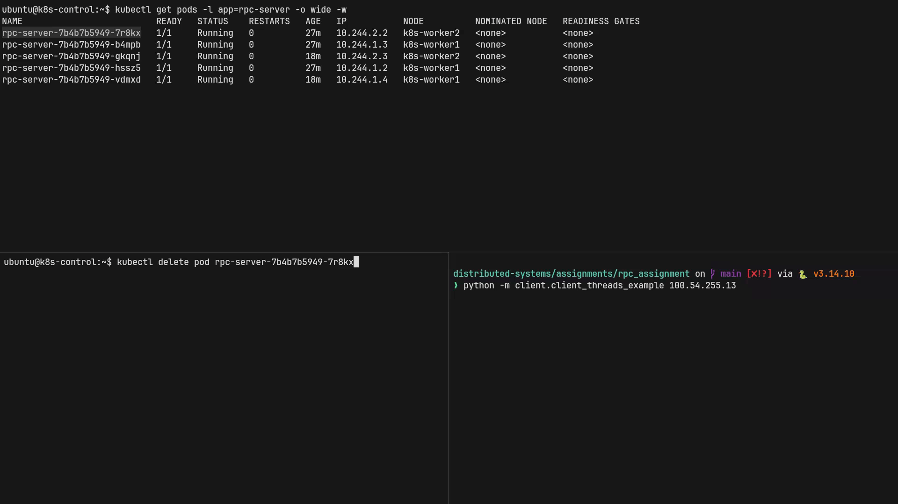
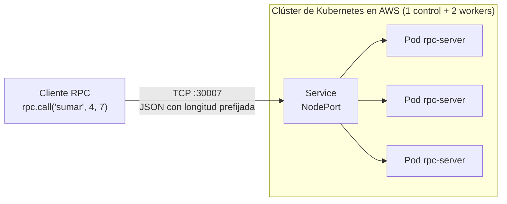
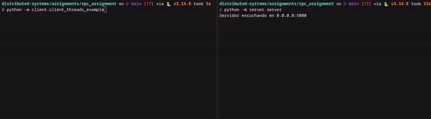

# Distributed Systems

Sistema RPC propio en Python sobre sockets TCP, contenedorizado con Docker y desplegado en un clúster de Kubernetes de tres nodos montado desde cero en AWS.

Prácticas y ejercicios de la asignatura **Sistemas Distribuidos**.


<p align="center">
  
</p>

## Qué hay aquí

| Proyecto                                                                  | Qué es                                                                                                | Tecnologías                                                    | Documentación                                                      |
| ------------------------------------------------------------------------- | ----------------------------------------------------------------------------------------------------- | -------------------------------------------------------------- | ------------------------------------------------------------------ |
| [Práctica 1: sistema RPC](assignments/rpc_assignment)                     | Capa RPC cliente-servidor escrita desde cero, con protocolo propio, gestión de errores y concurrencia | Python (solo biblioteca estándar), sockets TCP, hilos, AWS EC2 | [Memoria](assignments/rpc_assignment/docs/documentation.md)        |
| [Práctica 2: despliegue en Kubernetes](assignments/kubernetes_assignment) | El servidor RPC en un contenedor, desplegado, escalado y puesto a prueba en un clúster propio         | Docker, Kubernetes (kubeadm), AWS EC2, Bash                    | [Memoria](assignments/kubernetes_assignment/docs/documentation.md) |
| [Ejercicios de clase](exercises)                                          | Ejemplos cortos de TCP, hilos, stubs, RPC, Docker y Kubernetes                                        | Python, Docker, Kubernetes                                     | —                                                                  |

## Arquitectura



Cada pod ejecuta el mismo servidor: un socket de escucha que entrega cada conexión a un pool de hilos, y un *dispatcher* que valida la petición y ejecuta el procedimiento registrado.

## Práctica 1: sistema RPC sobre TCP

El cliente llama a `rpc.call("sumar", 4, 7)` como si la función fuera local; por debajo viaja una petición por la red hasta el servidor.

- **Protocolo propio.** Cada mensaje lleva una cabecera de 4 bytes con la longitud y un cuerpo JSON, lo que resuelve que TCP no conserve las fronteras entre mensajes.
- **Capas separadas.** Protocolo, cliente RPC, *dispatcher*, transporte y procedimientos viven en módulos distintos: añadir un procedimiento no toca la red.
- **Registro explícito de procedimientos.** Solo se puede invocar desde la red lo que se registra a mano.
- **Errores con código.** `INVALID_REQUEST`, `PROCEDURE_NOT_FOUND`, `INVALID_ARGUMENTS` y `FAILED_PROCEDURE_EXECUTION`, además de timeouts en cliente y en servidor.
- **Concurrencia.** `ThreadPoolExecutor` con 10 hilos: 15 llamadas simultáneas de 2 s terminan en 4,01 s, frente a los 30 s que tardarían en secuencia.
- **Sin dependencias.** Solo biblioteca estándar de Python.

<p align="center">
  
</p>

### Probarlo en local

```bash
git clone https://github.com/miguelandin/distributed-systems.git
cd distributed-systems/assignments/rpc_assignment

python -m server.server            # terminal 1: servidor en el puerto 5000
python -m client.client_example    # terminal 2: cliente de ejemplo
```

Tests (protocolo e integración):

```bash
python -m unittest discover -s tests
```

## Práctica 2: despliegue y escalado en Kubernetes

El servidor de la Práctica 1 se empaqueta en una imagen, se publica en [Docker Hub](https://hub.docker.com/r/miguelandin/rpc-server) y se despliega en un clúster creado a mano.

- **Clúster desde cero.** Tres instancias EC2 (`t3.medium`, Ubuntu Server): un nodo de control y dos workers unidos con `kubeadm`, con `containerd` como runtime.
- **Despliegue.** Un [`Deployment`](assignments/kubernetes_assignment/k8s/deployment.yaml) de 3 réplicas repartidas entre nodos y un [`Service`](assignments/kubernetes_assignment/k8s/service.yaml) de tipo NodePort en el puerto 30007.
- **Escalado.** De 3 a 5 réplicas con `kubectl scale`.
- **Prueba de carga.** 100 clientes concurrentes contra el clúster.
- **Tolerancia a fallos.** Se borra un pod en mitad de una petición pesada y el servicio sigue respondiendo (es el GIF del principio).
- **Automatización.** Scripts de Bash para construir la imagen e instalar o reiniciar Kubernetes en cada nodo.

### Probar la imagen

```bash
docker run -d --name rpc-server -p 5000:5000 miguelandin/rpc-server:1.0
```

### Desplegar en un clúster

```bash
kubectl apply -f assignments/kubernetes_assignment/k8s/deployment.yaml
kubectl apply -f assignments/kubernetes_assignment/k8s/service.yaml
```

El montaje completo del clúster, paso a paso y con capturas, está en la [memoria de la práctica](assignments/kubernetes_assignment/docs/documentation.md).

## Vídeos

- [Demostración del sistema RPC](https://github.com/miguelandin/distributed-systems/releases/download/video/Screencast.From.2026-10-28.23-23-15.mp4)
- [Demostración del despliegue en Kubernetes](https://github.com/miguelandin/distributed-systems/releases/download/assignment2-video/kubernetes-demo.mp4)

## Estructura del repositorio

```text
.
├── assignments/
│   ├── rpc_assignment/          Práctica 1: cliente, servidor, protocolo, tests y memoria
│   └── kubernetes_assignment/   Práctica 2: Dockerfile, manifiestos, scripts y memoria
└── exercises/
    ├── unit-1/                  TCP, hilos, stubs y RPC
    └── unit-2/                  Docker y Kubernetes
```

## Limitaciones conocidas

El sistema es didáctico: no tiene autenticación ni cifrado, no limita el tamaño de los mensajes y no corta la ejecución de procedimientos largos. Estas limitaciones y sus posibles mejoras (TLS, tamaño máximo de mensaje, reintentos seguros) están analizadas en la [memoria de la Práctica 1](assignments/rpc_assignment/docs/documentation.md).