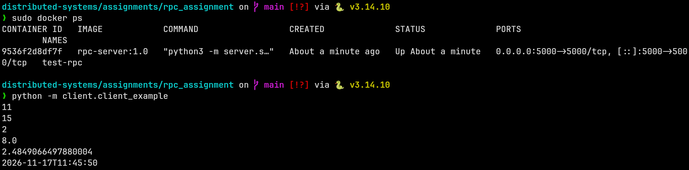
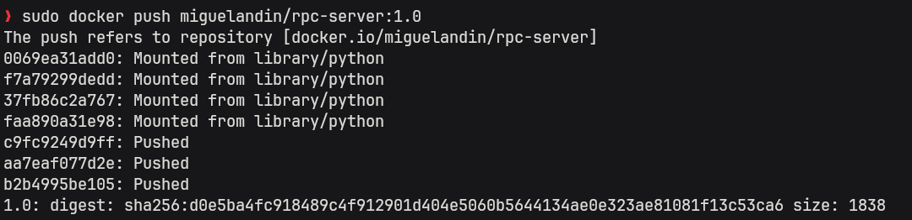
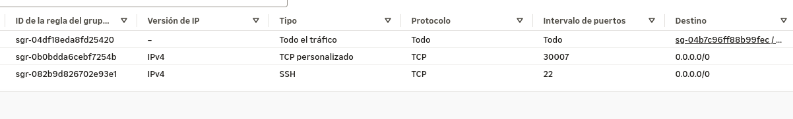
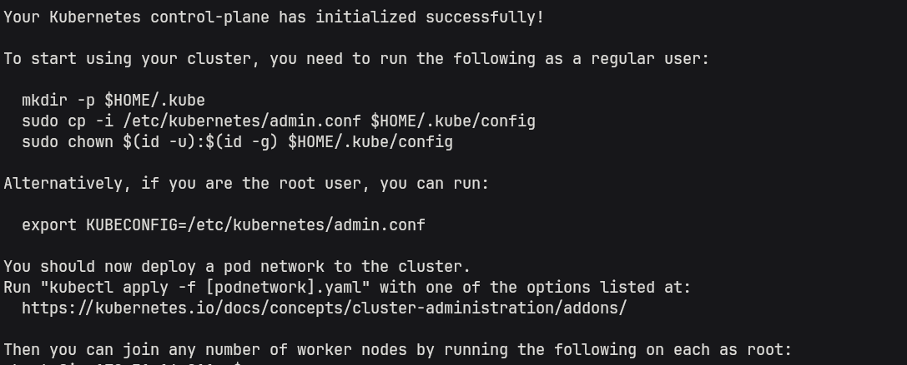
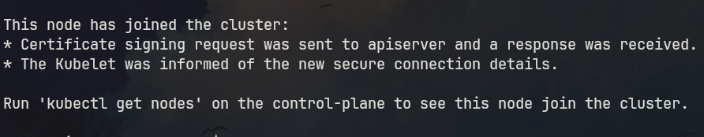
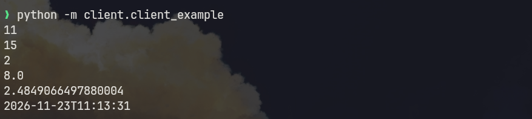
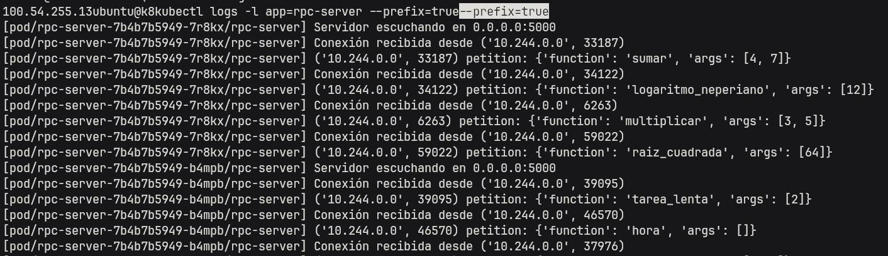
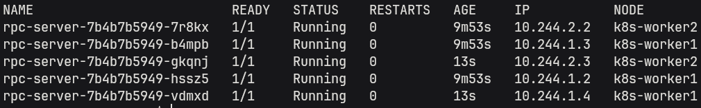
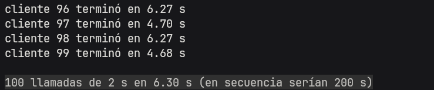
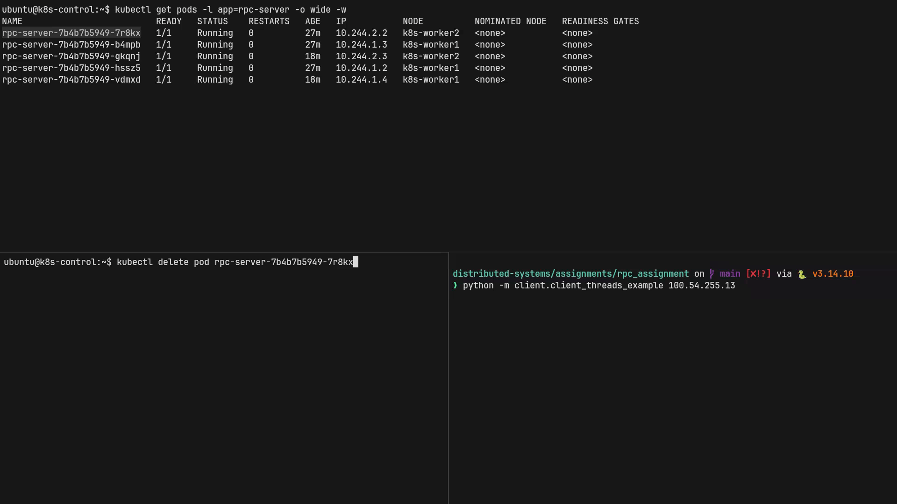

# Práctica 2 · Despliegue y escalado del servidor RPC con Kubernetes

**Sistemas Distribuidos** · Python · Docker · Kubernetes · AWS EC2

Esta memoria describe cómo se ha contenedorizado el servidor RPC de la Práctica 1, cómo se ha montado desde cero un clúster de Kubernetes de tres nodos en AWS y cómo se ha desplegado, escalado y puesto a prueba la aplicación sobre él.

## Índice

1. [Estructura del proyecto](#1-estructura-del-proyecto)
2. [Dockerización de la aplicación](#2-dockerización-de-la-aplicación)
3. [Publicación de la imagen en Docker Hub](#3-publicación-de-la-imagen-en-docker-hub)
4. [Montaje del clúster de Kubernetes en AWS](#4-montaje-del-clúster-de-kubernetes-en-aws)
5. [Despliegue en Kubernetes](#5-despliegue-en-kubernetes)
6. [Acceso desde el cliente](#6-acceso-desde-el-cliente)
7. [Escalado](#7-escalado)
8. [Prueba de carga](#8-prueba-de-carga)
9. [Tolerancia a fallos](#9-tolerancia-a-fallos)
10. [Vídeo demostrativo](#10-vídeo-demostrativo)
11. [Uso de IA](#11-uso-de-ia)

---

## 1. Estructura del proyecto

```text
.
├── assets/        Evidencias para la documentación (imágenes, GIF, logs)
├── deployment/    Dockerfile y script de construcción de la imagen
├── docs/          Documentación final, CHANGELOG.md y prompts de IA
└── k8s/           Manifiestos YAML y scripts de instalación de Kubernetes
```

| Directorio | Contenido |
|---|---|
| `deployment/` | `Dockerfile` y `deploy.sh`, el script que construye la imagen. |
| `docs/` | Esta documentación, el `CHANGELOG.md` que ha servido de apoyo para redactarla y `prompts.md`. |
| `k8s/` | `deployment.yaml`, `service.yaml` y los scripts `kub_install.sh` y `kub_reset.sh`. |
| `assets/` | Capturas, GIF y logs que se referencian a lo largo del documento. |

### Reutilización del código de la Práctica 1

El código Python de la imagen no se ha copiado dentro de este proyecto: se usa directamente el directorio `rpc_assignment`, situado un nivel por encima. Así no se duplica código y, si en el futuro cambia algo en la Práctica 1, el cambio se aplica también en la Práctica 2.

---

## 2. Dockerización de la aplicación

El `Dockerfile` está en `deployment/` y toma el código de `rpc_assignment`. Esto tiene una consecuencia práctica:

> **Importante:** el comando `docker build ...` debe ejecutarse desde `assignment/` para que el contexto de construcción incluya `rpc_assignment`.

Para no depender del directorio actual se ha creado el script de bash [`deploy.sh`](../deployment/deploy.sh), que construye la imagen desde cualquier ubicación. Es la forma recomendada de generarla.

### Prueba local

El contenedor funciona correctamente en local:



---

## 3. Publicación de la imagen en Docker Hub

La imagen se ha subido a la [cuenta de Docker Hub](https://hub.docker.com/repositories/miguelandin) en tres pasos.

### 3.1. Login

```bash
sudo docker login
```

Hay que hacerlo con `sudo`: de lo contrario las credenciales se guardan en otra ubicación y los comandos siguientes no las encuentran.

### 3.2. Tag

```bash
sudo docker tag rpc-server:1.0 miguelandin/rpc-server:1.0
```

- El primer nombre es la imagen local; el segundo, el nombre en el repositorio remoto.
- Lo que va después de `:` es la versión. Si no se indica, se usa `latest`.
- Si el repositorio remoto no existe, se crea uno público con ese nombre.

### 3.3. Push

```bash
sudo docker push miguelandin/rpc-server:1.0
```

La imagen queda publicada en [miguelandin/rpc-server](https://hub.docker.com/r/miguelandin/rpc-server):



### Comprobación rápida

```bash
sudo docker run -d --name rpc-server -p 5000:5000 miguelandin/rpc-server:1.0
```

---

## 4. Montaje del clúster de Kubernetes en AWS

El clúster se ha creado desde cero con tres instancias EC2: un nodo de control (`k8s-control`) y dos workers (`k8s-worker1` y `k8s-worker2`).

### 4.1. Security group

Se ha creado un security group con estas reglas de entrada:

| Tráfico         | Origen                   | Motivo                                    |
| --------------- | ------------------------ | ----------------------------------------- |
| SSH             | Cualquier IP             | Administrar las máquinas.                 |
| Puerto 30007    | Cualquier IP             | Acceder al servidor RPC desde el cliente. |
| Todo el tráfico | El propio security group | Comunicación entre los nodos del clúster. |



### 4.2. Instancia de control

La primera instancia EC2 es `k8s-control`. Además de actuar como nodo de control, sirve de plantilla para clonar los workers.

| Parámetro | Valor |
|---|---|
| Sistema operativo | Ubuntu Server 26.04 |
| Tipo de instancia | `t3.medium` |
| Almacenamiento | 28 GB (gp3) |
| Acceso | Par de claves |
| Red | Security group del paso anterior |

<details>
<summary>Comando de creación de la instancia</summary>

```bash
aws ec2 run-instances \
  --image-id 'ami-0aacbf72109c53c0c' \
  --instance-type 't3.medium' \
  --key-name 'passphrase' \
  --ebs-optimized \
  --block-device-mappings '{"DeviceName":"/dev/xvda","Ebs":{"Encrypted":false,"DeleteOnTermination":true,"Iops":3000,"SnapshotId":"snap-05d6088954edf1680","VolumeSize":28,"VolumeType":"gp3","Throughput":125}}' \
  --network-interfaces '{"AssociatePublicIpAddress":true,"DeviceIndex":0,"Groups":["sg-04b7c96ff88b99fec"]}' \
  --credit-specification '{"CpuCredits":"unlimited"}' \
  --metadata-options '{"HttpEndpoint":"enabled","HttpPutResponseHopLimit":2,"HttpTokens":"required"}' \
  --private-dns-name-options '{"HostnameType":"ip-name","EnableResourceNameDnsARecord":true,"EnableResourceNameDnsAAAARecord":false}' \
  --count '1'
```

</details>

### 4.3. Conexión por SSH e instalación de Kubernetes

Para conectarse con comodidad se recomienda añadir la instancia a `~/.ssh/config`:

```ssh
Host control
    Hostname <ip>
    User ubuntu
    IdentityFile ~/.ssh/cluster.pem
```

Con la conexión configurada, se copia el directorio [`k8s/`](../k8s/) a la máquina remota mediante `scp`:

```bash
scp -r k8s control:
```

Y desde la máquina remota se ejecuta el script de instalación de Kubernetes:

```bash
bash ./k8s/kub_install.sh
```

Si la instalación termina bien, la salida es similar a esta:



### 4.4. Creación de la AMI y de los workers

1. Se para la instancia de control.
2. Se crea una imagen desde **Acciones → Imágenes → Crear imagen**. En este caso se ha llamado `cluster-template`.
3. A partir de esa AMI se crean dos workers, en el **mismo security group** que el control.

<details>
<summary>Comando de creación de un worker</summary>

```bash
aws ec2 run-instances \
  --image-id 'ami-027dc2e31c9a1410d' \
  --instance-type 't3.medium' \
  --key-name 'cluster' \
  --ebs-optimized \
  --network-interfaces '{"AssociatePublicIpAddress":true,"DeviceIndex":0,"Groups":["sg-04b7c96ff88b99fec"]}' \
  --credit-specification '{"CpuCredits":"unlimited"}' \
  --tag-specifications '{"ResourceType":"instance","Tags":[{"Key":"Name","Value":"k8s-worker1"}]}' \
  --private-dns-name-options '{"HostnameType":"ip-name","EnableResourceNameDnsARecord":true,"EnableResourceNameDnsAAAARecord":false}' \
  --count '1'
```

</details>

### 4.5. Preparación de los workers

Como los workers son clones del control, hay que darles un nombre propio y reiniciar su configuración de Kubernetes. En cada worker (con su entrada correspondiente en `~/.ssh/config`) se ejecuta:

```bash
sudo hostnamectl set-hostname k8s-worker1   # k8s-worker2 en el segundo
sudo kubeadm reset
rm -f /home/ubuntu/.kube/config
```

### 4.6. Unión de los nodos al clúster

Desde el control se genera el comando de unión:

```bash
sudo kubeadm token create --print-join-command
```

El comando que devuelve se ejecuta en cada worker:

```bash
sudo kubeadm join 172.31.16.211:6443 --token <token> --discovery-token-ca-cert-hash sha256:<hash>
```

Si la unión es correcta, el worker muestra una salida como esta:



### 4.7. Estado final del clúster

Salida de `kubectl get nodes -o wide` en el nodo de control:

| Nodo | Estado | Rol | Antigüedad | Versión | IP interna |
|---|---|---|---|---|---|
| `k8s-control` | Ready | control-plane | 48m | v1.35.10 | 172.31.16.211 |
| `k8s-worker1` | Ready | — | 2m58s | v1.35.10 | 172.31.20.82 |
| `k8s-worker2` | Ready | — | 44s | v1.35.10 | 172.31.31.30 |

Los tres nodos comparten el mismo entorno: Ubuntu 26.04.1 LTS, kernel `7.0.0-1018-aws` y `containerd://2.2.2` como runtime de contenedores. Ninguno tiene IP externa asignada dentro del clúster.

---

## 5. Despliegue en Kubernetes

Con los tres nodos unidos, se despliega el servidor RPC mediante dos manifiestos:

- [`deployment.yaml`](../k8s/deployment.yaml)
- [`service.yaml`](../k8s/service.yaml)

Ambos están ya en las máquinas, porque se copiaron junto a los scripts dentro del directorio [`k8s/`](../k8s/).

Desde el control se aplican los manifiestos, lo que crea los pods del servidor RPC sobre los nodos y el servicio que los expone:

```bash
kubectl apply -f k8s/deployment.yaml
kubectl apply -f k8s/service.yaml
```

---

## 6. Acceso desde el cliente

Para comprobar el despliegue se ejecuta en local el cliente de `rpc_assignment`, apuntando a la IP pública de cualquier worker y al puerto **30007**.

**Desde el cliente:**



**Desde `kubectl`:**



---

## 7. Escalado

El deployment se escala de 3 a 5 réplicas:

```bash
kubectl scale deployment rpc-server --replicas=5
```



---

## 8. Prueba de carga

Para someter el sistema a carga concurrente se ejecuta `rpc_thread_example` con **100 workers**.

**Salida del cliente:**



**Log del deployment:** [`threads_deployment_log.txt`](../assets/threads_deployment_log.txt)

---

## 9. Tolerancia a fallos

Para comprobar la tolerancia a fallos se borra un pod mientras el cliente está realizando una petición muy pesada.



---

## 10. Vídeo demostrativo

Todas las evidencias de la práctica están recogidas en un vídeo, disponible en el [release del repositorio](https://github.com/miguelandin/distributed-systems/releases/download/assignment2-video/kubernetes-demo.mp4).

---

## 11. Uso de IA

Los prompts de IA utilizados durante la práctica están recogidos en [`prompts.md`](./prompts.md).
