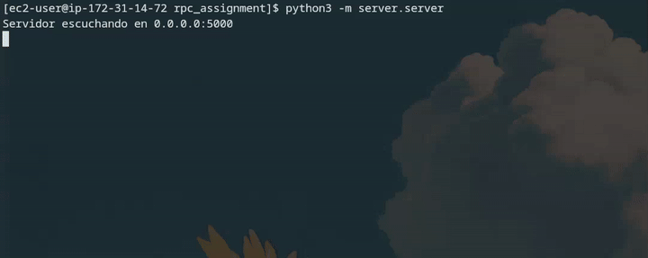
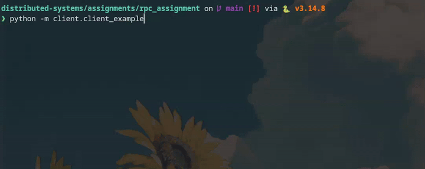

# Sistema RPC en Python sobre TCP

## Estructura del Proyecto
```text
.
├── assets/
│   ├── client.gif
│   └── server.gif
├── client/
│   ├── client_example.py     # Script principal para arrancar el cliente
│   └── rpc_client.py         # Lógica central del cliente RPC y conexión
├── common/
│   └── protocol.py           # Serialización, deserialización y formato JSON
├── server/
│   ├── procedures.py         # Funciones y cálculos expuestos por el servidor
│   ├── rpc_server.py         # Despachador de funciones y manejo de concurrencia
│   └── server.py             # Script principal para arrancar el servidor TCP
├── tests/
│   └── test_rpc.py           # Batería de pruebas del protocolo y conectividad
├── requirements.txt          # Dependencias (si aplica)
└── README.md                 # Este archivo
```

## Ejecución Local
Para probar el sistema en tu propio equipo, necesitarás abrir dos instancias de terminal separadas. El proyecto está diseñado para funcionar con Python 3.10+.

## Ejecución:
##### Levantar el Servidor
En tu primera terminal, colócate en la raíz del proyecto y ejecuta el servidor. Este registrará los procedimientos disponibles y se quedará a la escucha en el puerto local:
Bash

```bash
python -m server.server
```
##### Ejecutar el Cliente
Abre una segunda terminal, asegúrate de estar en la raíz del proyecto y lanza el cliente de pruebas. Este script se conectará al servidor e invocará las funciones remotas:

```bash
python -m client.client_example
```

## Demostración
A continuación se muestra cómo se comporta el sistema durante su ejecución:
##### Lado del Servidor

##### Lado del Cliente
