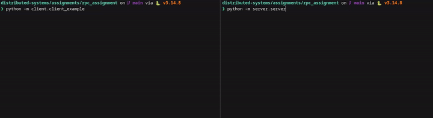
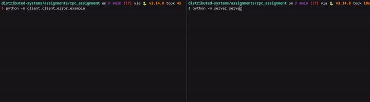
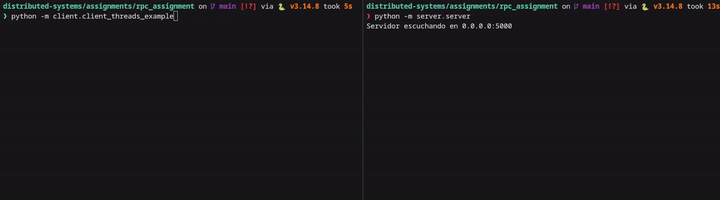

# Sistema RPC en Python sobre TCP

## Estructura del Proyecto
```text
.
├── assets/
│   ├── normal-example.gif
│   ├── error-example.gif
│   └── thread-example.gif
├── client/
│   ├── client_example.py     # Script principal para arrancar el cliente
│   └── rpc_client.py         # Lógica central del cliente RPC y conexión
├── common/
│   └── protocol.py           # Serialización, deserialización y formato JSON
├── server/
│   ├── procedures.py         # Funciones y cálculos expuestos por el servidor
│   ├── rpc_server.py         # Despachador de funciones (registro y ejecución)
│   └── server.py             # Script principal: servidor TCP y pool de hilos
├── tests/
│   └── test_rpc.py           # Batería de pruebas del protocolo y conectividad
├── requirements.txt          # Dependencias (si aplica)
└── README.md                 # Este archivo
```

## Ejecución
##### Levantar el Servidor
En tu primera terminal, colócate en la raíz del proyecto y ejecuta el servidor. Este registrará los procedimientos disponibles y se quedará a la escucha en el puerto local:
```bash
python -m server.server
```
##### Ejecutar el Cliente
Abre una segunda terminal, asegúrate de estar en la raíz del proyecto y lanza el cliente de pruebas. Este script se conectará al servidor e invocará las funciones remotas:
```bash
python -m client.client_example
```

## Ejemplos de uso

#### Peticiones correctas
<p align="center">
  
</p>

#### Peticiones incorrectas
<p align="center">
  
</p>

#### Varias peticiones concurrentes
<p align="center">
  
</p>
